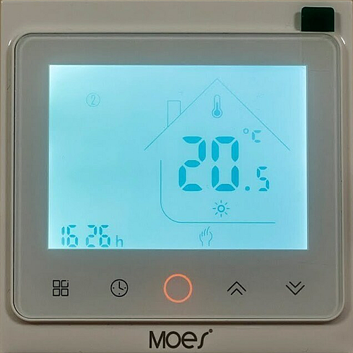
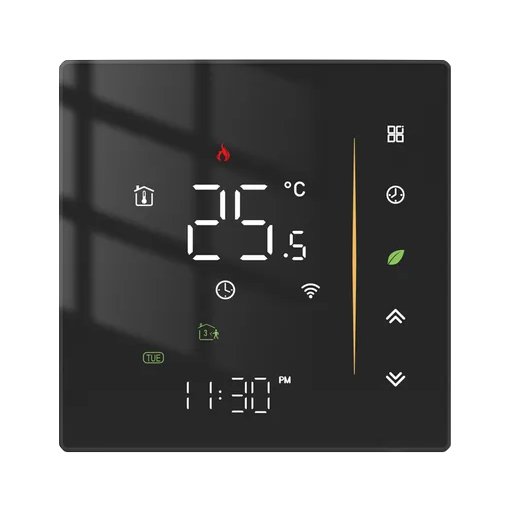
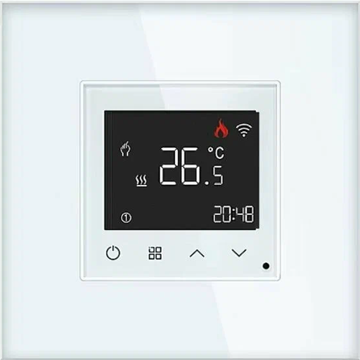

# Open Source Thermostat (OS Thermostat)

### Здесь собраны все проекты термостатов, у которых переписан заводской код на обоих **MCU**.

| **Custom Zigbee Model** | **Original Zigbee Manufacturer** | **Project**       |
|:-------------------:|:----------------------------:|:-----------------:|
| OS_Thermostat_r01 | `_TZE204_aoclfnxz` |  |
| OS_Thermostat_r02 | `_TZE204_u9bfwha0` `_TZE204_aoclfnxz` `_TZE200_edl8pz1k` `_TZE204_edl8pz1k` |  |
| OS_Thermostat_r0b | `_TZE204_8byfmxdv` `_TZE204_jrtvxwvy` |  |
